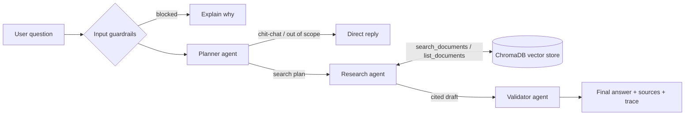

# Enterprise Document Assistant: Agentic RAG on Groq

Capstone project for **Generative AI and ML** (Edureka × Illinois Tech).

Upload enterprise documents (PDF, TXT, CSV, Excel) and ask questions in plain English.
Three AI agents work on each question. A **Planner** works out what is being asked. A **Research agent** searches a vector database and reasons over what it finds. A **Validator** checks the draft answer against the source passages before you see it. Every answer cites the exact passages it used.



## Features

- **Multi-format ingestion**: PDF (per page), TXT, CSV and Excel (each sheet, with an automatic summary of every table).
- **Semantic search**: documents are chunked with overlap, embedded locally (all-MiniLM-L6-v2) and stored in ChromaDB.
- **Two answering modes**:
  - *Agentic*: plan → retrieve (tool loop) → reason → validate.
  - *Simple RAG*: retrieve → generate, kept as a baseline.
- **Grounded answers**: answers carry `[S1]`-style citations, show the source passages, and include an agent trace you can inspect.
- **Guardrails**: upload and question validation, prompt-injection filtering, a relevance threshold (if nothing relevant is found, the app says so instead of answering), removal of hallucinated citations, a validator check for groundedness and safety, safety-refusal handling, and friendly API error messages.

## Quick start

Requires Python 3.10 or newer and an [Groq API key](https://console.groq.com/keys).

```bash
git clone https://github.com/0208-ajith/Edureka_Capstone.git
cd Edureka_Capstone
python -m venv .venv
# Windows: .venv\Scripts\activate    macOS/Linux: source .venv/bin/activate
pip install -r requirements-dev.txt
cp .env.example .env          # then put your GROQ_API_KEY in .env
streamlit run app.py
```

Open http://localhost:8501. Upload the files in `sample_docs/`, click **Ingest documents**, and try these questions:

- *How many unused leave days can I carry over, and when do they expire?*
- *Which region missed its revenue target in Q3 2026, and by how much?*
- *Compare the hotel limits for tier-one and tier-two cities.*

The first ingestion downloads the ~80 MB embedding model once.

## Tests

```bash
pytest
```

The 47 tests cover chunking, all four file loaders, the guardrails, the vector store, the Groq message translation, and the full agent workflow. The agent tests use a scripted fake LLM, so they need no API key.

## Docker

```bash
docker build -t doc-assistant .
docker run -p 8501:8501 -e GROQ_API_KEY=gsk_... -v doc-data:/app/data doc-assistant
```

## Documentation

[docs/DOCUMENTATION.md](docs/DOCUMENTATION.md) covers system setup, architecture, agent roles, guardrails, deployment (local, Docker and Streamlit Community Cloud), limitations, and the challenges faced during development.

## Submission zip

```bash
python scripts/make_submission.py      # -> dist/Edureka_Capstone_submission.zip
```

## Project layout

```
app.py                  Streamlit UI (upload, knowledge base, chat)
docqa/
  config.py             Settings from environment variables
  ingestion.py          PDF/TXT/CSV/Excel loaders + ingest pipeline
  chunking.py           Recursive, overlapping text splitter
  vector_store.py       ChromaDB store with local embeddings
  retrieval.py          Relevance-filtered search + citation labels
  llm.py                Groq client wrapper and error handling
  rag.py                Simple RAG pipeline
  agents.py             Planner, Research and Validator agents + orchestrator
  guardrails.py         Input validation and output checks
tests/                  pytest suite
sample_docs/            Fictional sample documents for the demo
scripts/                Submission packaging
docs/                   Project documentation
```
