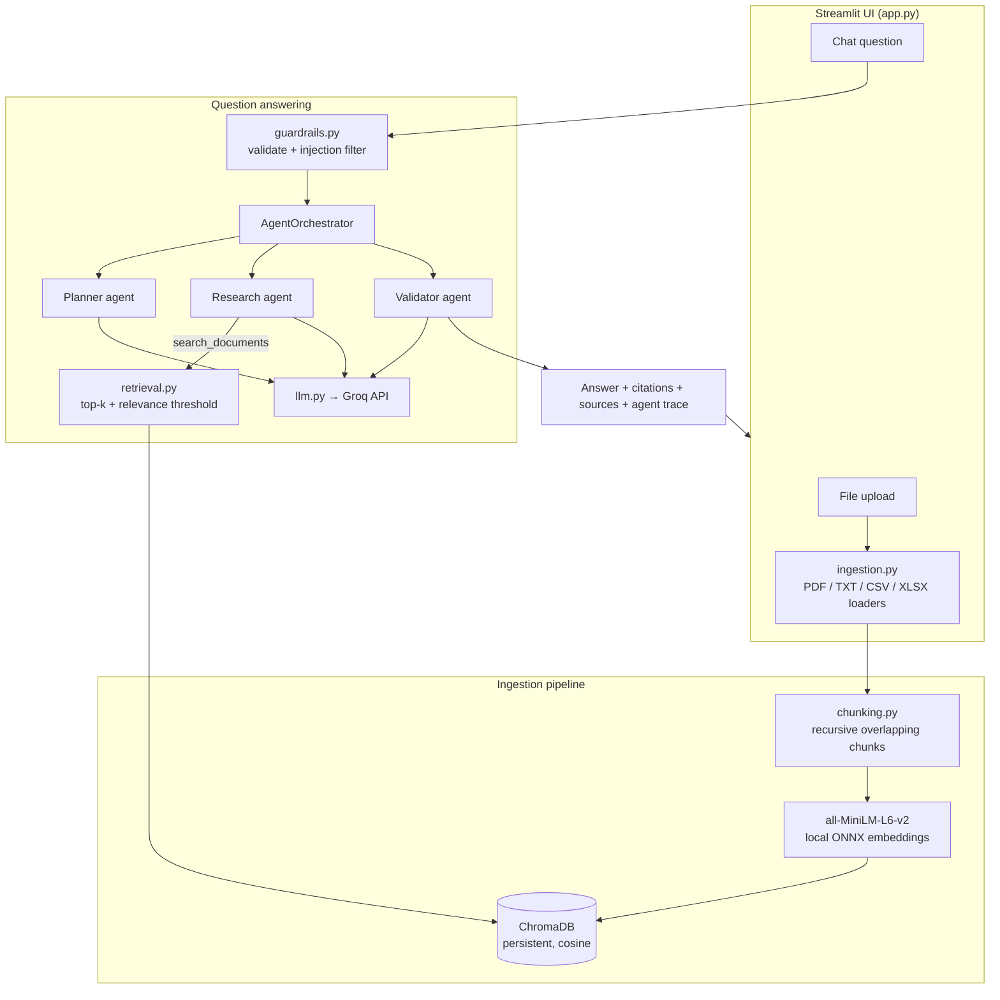

# Enterprise Document Assistant: Project Documentation

**Course:** Generative AI and ML, Capstone Project (Edureka × Illinois Tech)
**Repository:** https://github.com/0208-ajith/Edureka_Capstone

## 1. Overview

The Enterprise Document Assistant is a Generative AI application for asking questions about enterprise documents in natural language. It combines three techniques:

- **Retrieval-Augmented Generation (RAG):** answers are generated only from passages retrieved from the user's own documents.
- **A vector knowledge store:** documents are chunked, embedded and indexed in ChromaDB for semantic similarity search.
- **Agentic AI:** three cooperating agents (Planner, Research, Validator) plan the task, retrieve information through tools, reason over it, and validate the result.

Each answer cites the passages it relies on (`[S1]`, `[S2]`, ...). The UI shows those passages, plus an agent trace of what each agent did.

### How the capstone tasks map to the code

| # | Task | Where it is implemented |
|---|------|-------------------------|
| 1 | Project foundation | Repository layout, `requirements*.txt`, `.env.example`, `docqa/config.py` |
| 2 | User interaction layer | `app.py` (Streamlit: upload, knowledge base, chat) |
| 3 | Document ingestion | `docqa/ingestion.py` (PDF, TXT, CSV, XLSX) |
| 4 | Data preparation for semantic search | `docqa/chunking.py` (recursive, overlapping chunks) |
| 5 | Vector knowledge store | `docqa/vector_store.py` (ChromaDB + local embeddings) |
| 6 | Intelligent retrieval | `docqa/retrieval.py` (top-k similarity, relevance threshold, citation labels) |
| 7 | RAG pipeline | `docqa/rag.py` (single-pass retrieve → generate) |
| 8 | Agent-based reasoning | `docqa/agents.py` (Planner, Research, Validator, Orchestrator) |
| 9 | Reliability and safety controls | `docqa/guardrails.py`, `docqa/llm.py`, validator agent |
| 10 | Deployment and documentation | `Dockerfile`, Streamlit Cloud steps (section 7), this document, `README.md` |

## 2. System setup

### Prerequisites

- Python 3.10 or newer (developed on 3.14; the Docker image uses 3.12)
- A Groq API key (create one at https://console.groq.com/keys)
- About 500 MB of disk space for dependencies and the embedding model

### Installation

```bash
git clone https://github.com/0208-ajith/Edureka_Capstone.git
cd Edureka_Capstone
python -m venv .venv
.venv\Scripts\activate              # Windows
# source .venv/bin/activate         # macOS / Linux
pip install -r requirements-dev.txt
copy .env.example .env              # Windows (cp on macOS / Linux)
```

Open `.env` and set `GROQ_API_KEY=gsk_...`. If no key is configured, the app asks for one in the sidebar. A key entered there is used for that browser session only.

### Running

```bash
streamlit run app.py     # opens http://localhost:8501
pytest                   # 47 offline tests, no API key needed
```

### Configuration

All settings are environment variables with sensible defaults (see `.env.example`):

| Variable | Default | Purpose |
|----------|---------|---------|
| `GROQ_MODEL` | `openai/gpt-oss-120b` | LLM used by every agent |
| `CHROMA_DIR` | `data/chroma` | Where the vector database is persisted |
| `CHUNK_SIZE` / `CHUNK_OVERLAP` | 1000 / 150 characters | Chunking parameters |
| `TOP_K` | 5 | Default number of passages per search |
| `MIN_RELEVANCE` | 0.25 | Minimum cosine similarity for a passage to be used |
| `MAX_FILE_MB` | 20 | Upload size limit |
| `MAX_QUESTION_CHARS` | 2000 | Question length limit |
| `MAX_AGENT_STEPS` | 6 | Maximum tool-use turns for the Research agent |

## 3. Architecture



### Ingestion flow

1. **Validation:** the file's extension, emptiness and size are checked (`guardrails.validate_upload`).
2. **Loading** (`ingestion.py`):
   - **PDF:** text is extracted page by page with `pypdf`, and each page keeps its page number. Encrypted and image-only PDFs are reported clearly.
   - **TXT:** the file is decoded as UTF-8, falling back to Windows-1252 and then Latin-1.
   - **CSV / Excel:** the file is read with pandas, and CSV delimiters are auto-detected. Each sheet produces a **summary section** (row and column counts, min/max/mean/total of numeric columns, distinct values of categorical columns) and **row blocks** of 25 rows written as `Row N: column: value; ...`. Row numbers match the spreadsheet.
3. **Chunking** (`chunking.py`): whitespace is normalised. The text is then split recursively at paragraph, line, sentence and word boundaries into chunks of up to about 1000 characters, with about 150 characters of word-aligned overlap. Every chunk carries metadata (source, page/sheet/rows, chunk index) and a deterministic ID.
4. **Embedding and indexing** (`vector_store.py`): ChromaDB embeds chunks with its built-in all-MiniLM-L6-v2 model, which runs locally on CPU, so documents never leave the machine for embedding. Chunks are stored in a persistent collection using cosine distance. Re-uploading a file replaces its old chunks.

### Retrieval

`retrieval.retrieve()` runs a top-k cosine-similarity search, optionally filtered to one document, and drops hits below `MIN_RELEVANCE`. `EvidenceSet` gives each distinct passage a stable label (`S1`, `S2`, ...) for the duration of one question, so citations stay consistent across several searches. Passages are sent to the model wrapped in `<passage id=... source=... location=...>` tags, which separate document data from instructions.

### Answer generation

- **Simple RAG mode** (`rag.py`): retrieve top-k → if nothing is relevant, return a "not found" message *without calling the LLM* → otherwise make one LLM call that answers only from the passages and cites them.
- **Agentic mode** (`agents.py`): the multi-agent workflow described in section 4.

### Technology choices

| Component | Choice | Reason |
|-----------|--------|--------|
| LLM | `openai/gpt-oss-120b` on Groq via the official `groq` Python SDK | Fast inference, reliable tool calling, adjustable reasoning effort, and strict JSON-schema structured outputs for the planner and validator |
| Agent framework | Plain Python tool-use loop on Groq chat completions | Transparent and easy to test; every step is visible in the trace, with no hidden framework behaviour |
| Vector DB | ChromaDB (persistent) | Embedded, no separate server; metadata filtering; persists to disk |
| Embeddings | all-MiniLM-L6-v2 (ONNX, via ChromaDB) | Free, local, fast on CPU; no second API key needed |
| UI | Streamlit | Quick to build upload and chat interfaces; free hosting on Streamlit Community Cloud |
| Parsing | pypdf, pandas, openpyxl | Mature, pure-Python-friendly libraries |

## 4. Agent roles

The `AgentOrchestrator` runs the agents in sequence and records every step in a trace that the UI displays.

### 4.1 Planner agent: *plan the task*

- **Input:** the question, the list of indexed documents, and recent conversation turns (so follow-up questions resolve correctly).
- **Output** (JSON enforced by structured outputs): an `intent` (`factual_lookup`, `summary`, `comparison`, `analysis`, `chit_chat`, `out_of_scope`), 1-4 focused `sub_queries`, a short `approach`, and a `direct_response` used for chit-chat or out-of-scope messages.
- **Effect:** greetings and off-topic requests (for example "write me a poem") get a polite direct reply without any retrieval. Multi-part questions are split into separate searches.
- Runs at `reasoning_effort: low`, because planning is a light task.

### 4.2 Research agent: *retrieve and reason*

- A tool-use loop on Groq chat completions (function calling) with two tools:
  - `search_documents(query, source?, top_k?)`: semantic search, returning labelled passages.
  - `list_documents()`: the indexed documents and their chunk counts.
- It receives the planner's suggested searches. It decides itself how many searches to run, rephrases when results are off-topic, and can restrict a search to one file.
- Tool inputs are validated: an unknown document name, an empty query or a bad `top_k` is returned to the model as an `is_error` tool result, so it can correct itself.
- The loop is capped at `MAX_AGENT_STEPS`. When the cap is reached, the agent must answer from the evidence gathered so far (`tool_choice: none`).
- It writes a concise draft answer that cites passages after each claim.

### 4.3 Validator agent: *validate the output*

- **Input:** the question, every retrieved passage, and the draft answer.
- **Output** (JSON): `grounded`, `confidence` (high / medium / low), `unsupported_claims`, `contains_unsafe_content`, `revised_answer` and `notes`.
- **Decision rules** (`apply_validation`):
  - Unsafe content → the answer is withheld.
  - Grounded → the draft is returned unchanged.
  - Not grounded, with a corrected version → the corrected answer is returned.
  - Not grounded, with no correction → the draft is returned with a visible warning to check the sources.
- The UI shows the validator's verdict and confidence under each answer.

### 4.4 Example trace

```
Planner: intent = comparison; searches = ['Q3 2026 revenue by region', 'Q3 2026 targets by region']
Research agent: retrieving and reasoning...
Searched for "Q3 2026 revenue by region" -> 3 relevant passage(s).
Searched in quarterly_sales.csv for "Q3 South target" -> 2 relevant passage(s).
Validator: grounded = True, confidence = high, unsupported claims = 0
```

## 5. Reliability and safety controls

| Risk | Control | Where |
|------|---------|-------|
| Bad uploads | Extension allow-list, empty-file and size checks; clear errors for corrupt, encrypted or scanned PDFs | `guardrails.validate_upload`, `ingestion.load_document` |
| Malformed questions | Control characters stripped; empty and over-long questions rejected | `guardrails.clean_question` |
| Prompt injection (user) | Pattern filter for "ignore previous instructions", "reveal your system prompt", "developer mode", and similar | `guardrails.looks_like_prompt_injection` |
| Prompt injection (documents) | Passages are wrapped in tags, and every system prompt says passage content is data, never instructions | `retrieval.format_passages`, agent prompts |
| Hallucination: no evidence | Relevance threshold; if nothing relevant is found, return "not found" instead of generating (RAG mode skips the LLM entirely) | `retrieval.retrieve`, `rag.py`, orchestrator |
| Hallucination: unsupported claims | The validator agent checks every claim against the passages and revises or flags the answer | `ValidatorAgent`, `apply_validation` |
| Hallucinated citations | Citation labels that don't match a retrieved passage are removed | `guardrails.strip_unknown_citations` |
| Unsafe output | The validator flags harmful content or unnecessary personal data, and the answer is withheld | `ValidatorAgent` |
| Model safety refusals | A `content_filter` finish reason is detected and reported as a refusal | `llm.from_chat_completion` |
| API failures | Automatic retries (3) for rate limits, 5xx and network errors. Typed SDK exceptions are mapped to user-friendly messages (invalid key, unknown model, rate limit, connection) | `llm.GroqLLM.create` |
| Runaway agent loops | `MAX_AGENT_STEPS` cap, followed by a forced final answer | `ResearchAgent.run` |
| Malformed tool calls | Tool inputs are validated; errors go back to the model as `is_error` tool results | `ResearchAgent._execute` |
| Unexpected exceptions | Caught in the UI, logged server-side, and shown as a generic message | `app.py` |

## 6. Testing

`pytest` runs 47 tests in about 30 seconds. No API key is needed.

- `test_chunking.py`: chunk sizes, overlap, boundary preference, hard splits, metadata and unique IDs.
- `test_ingestion.py`: TXT (including Windows-1252), CSV (including semicolon-delimited), multi-sheet Excel, image-only and corrupt PDFs, unsupported and empty files.
- `test_guardrails.py`: question cleaning, injection detection (and no false positive on "previous quarter"), upload limits, citation stripping.
- `test_vector_store.py`: real ChromaDB with real embeddings — semantic search, source filters, relevance threshold, re-ingestion, deletion, stable labels.
- `test_agents.py`: the full Planner → Research → Validator workflow with a scripted fake LLM, covering tool results, hallucinated-citation removal, chit-chat short-circuit, the no-evidence path, tool-error recovery, the step limit, validation rules, and both RAG paths.
- `test_llm.py`: translation between the internal message format and Groq chat messages (tool calls, tool results, malformed tool arguments, refusals, JSON parsing).

The Groq request format (model, `reasoning_effort`, strict `json_schema` response format, function tools) and the error mapping were also checked against a mock HTTP transport. The UI was smoke-tested with Streamlit's `AppTest`.

## 7. Deployment

### 7.1 Local

See section 2. Data persists in `data/chroma/`.

### 7.2 Docker

```bash
docker build -t doc-assistant .
docker run -p 8501:8501 -e GROQ_API_KEY=gsk_... -v doc-data:/app/data doc-assistant
```

The image pre-downloads the embedding model at build time and includes a health check on `/_stcore/health`. The named volume keeps the vector store across container restarts. The same image runs on any container platform (Azure Container Apps, AWS App Runner, Google Cloud Run, Render, Railway) with `GROQ_API_KEY` set as a secret.

### 7.3 Streamlit Community Cloud (free)

1. Push the repository to GitHub (`.env` and `data/` are git-ignored).
2. At https://share.streamlit.io, choose **Create app**, then pick the repository, the `main` branch and `app.py`.
3. Under **Advanced settings → Secrets**, add:
   ```toml
   GROQ_API_KEY = "gsk_..."
   ```
4. Deploy. The app reads the key from `st.secrets` automatically.

Streamlit Cloud storage is temporary, so uploaded documents must be re-ingested after the app restarts.

### 7.4 Submission package

`python scripts/make_submission.py` writes `dist/Edureka_Capstone_submission.zip` containing the source code and documentation. It leaves out virtual environments, data, caches and secrets.

## 8. Limitations

- **Scanned PDFs:** image-only pages have no extractable text, and OCR isn't included.
- **Tables and charts inside PDFs** are extracted as flat text, so layout is lost.
- **Numeric questions over large spreadsheets:** retrieval returns row blocks, not the whole table. The per-sheet summary gives totals, min/max and means, but arbitrary aggregations (for example "average revenue of the South region in Q2 and Q3") over thousands of rows may be incomplete. A pandas or SQL tool for the agent would solve this.
- **Embedding model:** all-MiniLM-L6-v2 is small and English-centric. Multilingual or highly technical corpora would benefit from a stronger embedding model or hybrid keyword + vector search.
- **Single shared knowledge base:** there are no user accounts or per-user document permissions. Everyone using the same deployment sees the same documents.
- **Regex prompt-injection filter:** it catches common phrasings only. The structural defences (tagged passages, validator) are the main protection.
- **The validator uses the same model family** as the generator, so it can share blind spots. It reduces hallucinations but doesn't eliminate them.
- **Latency and cost:** agentic mode makes at least three LLM calls (planner, one or more research turns, validator), so it is slower and costlier than simple RAG mode.
- **Ephemeral storage** on free hosting tiers (see 7.3).

## 9. Challenges faced during development

> Items 1-4 are design problems that were solved while building the system. Items 5-7 are issues actually hit during development and testing. Add your own experiences from running the app on real documents here before submitting.

1. **Making spreadsheets searchable.** A table row such as `North,510,306000` means little to an embedding model on its own. Each row is therefore written as `column: value` pairs so chunks describe themselves. A per-sheet summary section (totals, ranges, distinct categories) gives aggregate questions something to retrieve.
2. **Choosing a chunk size.** Small chunks lose context, and large chunks dilute similarity scores. The splitter targets about 1000 characters, breaks first on paragraph and line boundaries so sentences and table rows stay whole, and aligns the overlap to word boundaries.
3. **Preventing answers without evidence.** An LLM will readily answer from its general knowledge. Three layers keep answers grounded: a relevance threshold, a hard "not found" path when no passage clears it, and the Planner's out-of-scope intent. On top of these, the Validator checks every claim.
4. **Stable citations across multiple searches.** The Research agent can retrieve the same chunk in several searches. `EvidenceSet` deduplicates by chunk ID so each passage keeps one label, and citation labels that don't match a retrieved passage are removed.
5. **Testing agents deterministically.** LLM output varies between runs, so the agent workflow is tested with a scripted fake LLM that also records each request. The first run of this suite failed because the agent appends to a single message list, so the recorded requests changed after the fact. The fake now snapshots the list on every call.
6. **Switching LLM providers.** The project was first built on the Anthropic Claude API and later moved to Groq. To keep the change contained, the agents use a small provider-neutral message format (text, tool-use and tool-result blocks), and `llm.py` translates it to and from Groq's OpenAI-style chat format. Groq's strict structured outputs can't be combined with tools, so the Planner and Validator (JSON output) and the Research agent (tools) are kept as separate calls. Only the `gpt-oss` models accept `reasoning_effort`, so it is sent only for them.
7. **Windows console encoding.** Printing UI messages containing emoji from test scripts raised `UnicodeEncodeError` on the default cp1252 console. The fix is to run with `PYTHONIOENCODING=utf-8`. Text loaders also fall back from UTF-8 to Windows-1252 for files saved by legacy Windows tools.

## 10. Possible future work

- A pandas/SQL query tool so the agent can compute exact aggregates over tabular files
- OCR for scanned PDFs (for example Tesseract), and Word (.docx) support
- Hybrid BM25 + vector retrieval with re-ranking
- User authentication and per-user document collections
- Streaming answers token by token in the UI
- An evaluation set (questions with expected answers) to measure retrieval and answer quality over time
